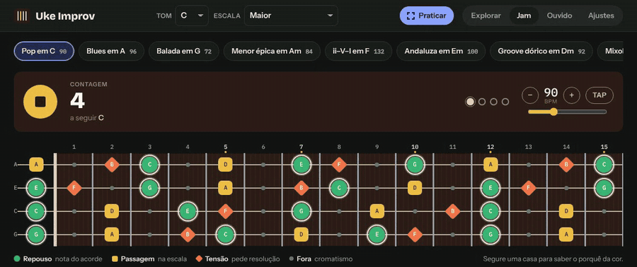
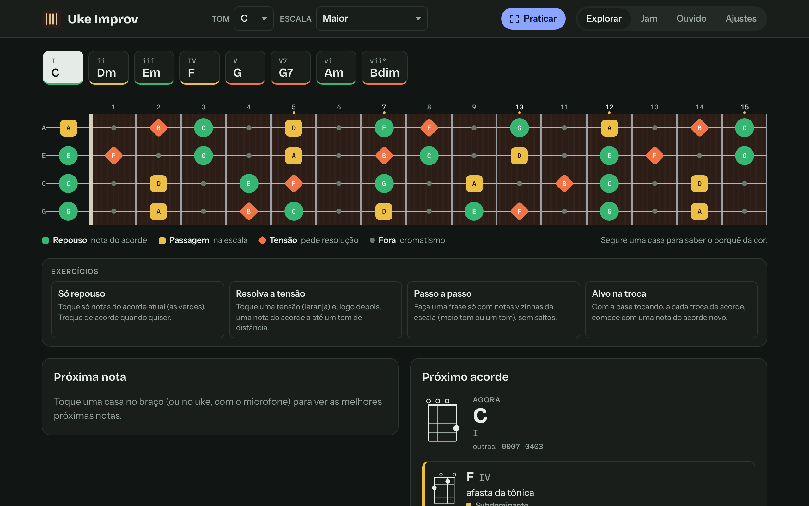
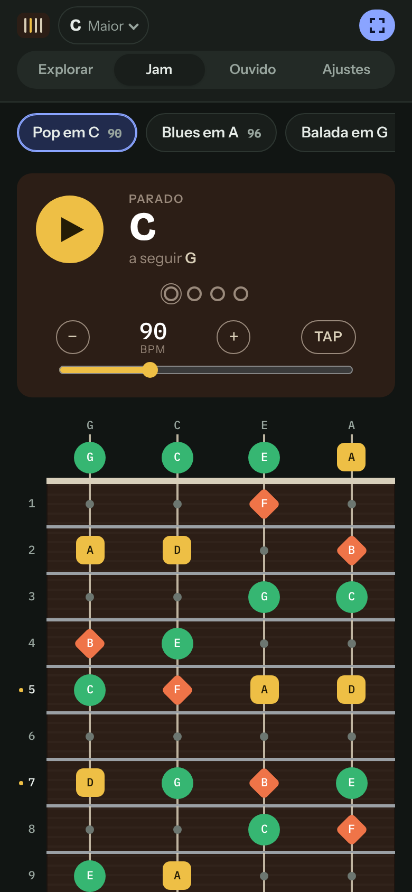

# Uke Improv

Assistente de improviso e harmonia para ukulele. Escolha o tom e o acorde atual, e o braço mostra quais notas soam bem a seguir e quais acordes combinam como próximos. Toque no aparelho ou no uke de verdade, com o microfone.

**App:** [uke-improv.vercel.app](https://uke-improv.vercel.app): instalável como PWA e funciona offline.

<p align="center">
  
</p>

<p align="center">
  
  &nbsp;
  
</p>

## O que faz

| Área                    | Recursos                                                                                                                                                                                                                  |
| ----------------------- | ------------------------------------------------------------------------------------------------------------------------------------------------------------------------------------------------------------------------- |
| **Braço sugestivo**     | Cada casa recebe cor e forma: repouso (círculo), passagem (quadrado), tensão (losango) ou fora. As 3 melhores próximas notas ficam numeradas. Toque longo numa casa explica o grau, o intervalo e para onde a nota tende. |
| **Escalas e tons**      | 12 tônicas; escalas maior, menor, pentatônicas maior e menor, blues, dórica, mixolídia e menor harmônica; modo "só arpejo" e capotraste nas casas 1–7.                                                                    |
| **Próximo acorde**      | Sugestões por função harmônica, dominantes secundárias e empréstimo modal, com diagramas GCEA.                                                                                                                            |
| **Escuta**              | Detecção de nota (McLeod/pitchy) e de acorde (cromagrama) pelo microfone, afinador, calibração de ganho e limiar e análise de arquivo gravado. A nota ouvida vai para a posição mais provável no braço.                   |
| **Jam**                 | Base em loop com acorde, baixo e bateria em 4/4, 3/4 e 6/8, com até 2 acordes por compasso. Estilos pop, reggae, bossa nova, swing e valsa, tap tempo e presets.                                                          |
| **Looper**              | Até 4 camadas sincronizadas ao compasso, com compensação de latência.                                                                                                                                                     |
| **Gravar e reouvir**    | Grava o microfone e as notas detectadas. Na reprodução, o braço marca cada nota e mostra um resumo do take.                                                                                                               |
| **Analisador de cifra** | Cole uma cifra (com letra): o app acha o tom, sugere a escala, explica cada acorde e leva a progressão para o jam.                                                                                                        |
| **Treino**              | Exercícios guiados ("só repouso", "resolva a tensão", "passo a passo", "alvo na troca") e treino de ouvido (intervalos, maior × menor, função harmônica).                                                                 |
| **Modo prática**        | Tela cheia pensada para o celular deitado, com janela de 5 casas que segue a mão e tela acesa (Wake Lock).                                                                                                                |
| **Conta (opcional)**    | E-mail e senha. Ajustes, progressões próprias e placar sincronizam entre aparelhos. Sem conta, tudo fica no aparelho.                                                                                                     |

## Começar

Requer Node 20.19+ ou 22.12+.

```bash
git clone https://github.com/VictorDepX/uke-improv.git
cd uke-improv
npm install
npm run dev
```

Abra o endereço que o Vite mostrar. O microfone funciona em `localhost` e em qualquer endereço HTTPS.

## Comandos

| Comando                  | O que faz                                                                                                        |
| ------------------------ | ---------------------------------------------------------------------------------------------------------------- |
| `npm run dev`            | Servidor local com recarga, incluindo o proxy de `/api` para as contas                                           |
| `npm test`               | Vitest: 238 testes (teoria, detectores com sinais sintetizados, motor da base, looper, sincronização, interface) |
| `npm run typecheck`      | TypeScript estrito, sem emitir                                                                                   |
| `npm run lint`           | ESLint                                                                                                           |
| `npm run format`         | Prettier                                                                                                         |
| `npm run build`          | Build de produção em `dist/`, com service worker gerado                                                          |
| `npm run preview`        | Serve o `dist/` localmente                                                                                       |
| `npm run build:artifact` | Página HTML única, sem PWA e sem contas (para hospedar como arquivo avulso)                                      |

Para regerar os ícones a partir de `scripts/icon.svg`, rode `python3 scripts/make-icons.py`.

## Arquitetura

```
src/
  core/        teoria musical, ritmo, cifra, exercícios, merge da sincronização (funções puras)
  audio/
    analysis/  detectores de nota e acorde, calibração (recebem Float32Array)
    engine/    microfone, síntese, motor da base (Tone.js, carregado sob demanda), gravador
    looper/    captura por AudioWorklet e reprodução em loop
  store/       store único (Zustand + persist em localStorage)
  sync/        cliente de conta e dados; proxy do Neon Auth
  ui/          React: páginas, componentes e hooks
api/
  neon-auth.ts função Edge da Vercel que repassa /api/auth ao Neon Auth
scripts/       plugin do service worker, ícones, conversão para página única
```

Algumas decisões:

- **O núcleo não depende do navegador.** `core/` e `audio/analysis/` são puros e testados sem DOM. Os detectores são validados com síntese aditiva e Karplus-Strong de semente fixa (`src/test/signals.ts`).
- **Sugestões são derivadas, não armazenadas.** O store guarda só tom, acorde, ajustes e progresso. Os componentes calculam o resto por seletores, e os módulos só conversam pelo store.
- **A base é uma grade de semicolcheias.** `sequencer.ts` transforma (passo, progressão, compasso, estilo) em eventos por uma função pura, e `jam.ts` só agenda esses eventos no Tone.js. Mudanças entram no próximo compasso.
- **A posição no braço é escolhida, não adivinhada às cegas.** No GCEA, 19 das 25 notas existem em mais de um lugar. Uma nota ouvida vai para a casa dentro da janela visível com o menor deslocamento da mão (`resolvePosition` em `core/fretboard.ts`). As outras posições da mesma nota aparecem pontilhadas.

## Contas e sincronização

A parte de contas é opcional: sem ela, o app funciona por completo e guarda tudo no aparelho.

- **Autenticação:** [Neon Auth](https://neon.com/docs/neon-auth/overview) (Better Auth gerenciado), com e-mail e senha.
- **Dados:** Neon Data API (PostgREST) numa tabela `user_data` com RLS. O JWT curto vem de `/token`.
- **Mesmo domínio:** tudo passa por `/api` no domínio do app, então o cookie de sessão é primário em qualquer navegador, inclusive Safari.
  - Produção: `vercel.json` reescreve `/api/data/*` para o Data API e `/api/auth/*` para a função `api/neon-auth.ts`. Ela remove `X-Forwarded-Host`, que o Neon Auth recusa.
  - Desenvolvimento: o proxy do Vite faz o mesmo e respeita `HTTPS_PROXY`.
- **Regra de merge:** cada bloco (ajustes, progressões, progresso) guarda o instante da última mudança, e a versão mais nova vence (`core/sync.ts`). As mudanças sobem 1,5 s depois de feitas e quando o app vai para segundo plano. Ao voltar ao app, ele puxa do servidor.

### Usar sua própria instância

1. Crie um projeto no [Neon](https://neon.com) e ative o **Neon Auth** e o **Data API**.
2. Em Neon Auth, adicione o domínio do seu deploy aos domínios confiáveis.
3. Crie a tabela:

   ```sql
   create table public.user_data (
     user_id         text primary key default auth.user_id(),
     settings        jsonb,
     settings_at     timestamptz,
     progressions    jsonb,
     progressions_at timestamptz,
     progress        jsonb,
     progress_at     timestamptz,
     updated_at      timestamptz not null default now()
   );

   alter table public.user_data enable row level security;

   create policy "own row" on public.user_data for all to authenticated
     using ((select auth.user_id()) = user_id)
     with check ((select auth.user_id()) = user_id);

   grant select, insert, update, delete on public.user_data to authenticated;
   ```

4. Troque as URLs do Neon pelas do seu projeto em três lugares:
   - `src/sync/proxy.ts`: `NEON_AUTH_URL`.
   - `vite.config.ts`: `NEON_AUTH` e `NEON_DATA`.
   - `vercel.json`: destino do rewrite `/api/data`.
5. Importe o repositório na Vercel. O framework (Vite), o build e a saída já estão em `vercel.json`, e cada push na `main` gera um deploy.

## Limitações conhecidas

- **Posição pelo microfone:** o microfone não sabe qual corda foi tocada, então a posição é uma estimativa. Fixe uma janela de casas em Ajustes para restringi-la.
- **Página avulsa sem microfone:** em páginas embutidas sem permissão de microfone (como a versão de página única), use "Analisar gravação", que roda os mesmos detectores.
- **Afinação:** só GCEA (padrão e com Sol grave). Outros instrumentos estão em estudo.

## Licença

[MIT](LICENSE) © 2026 Victor Daniel
